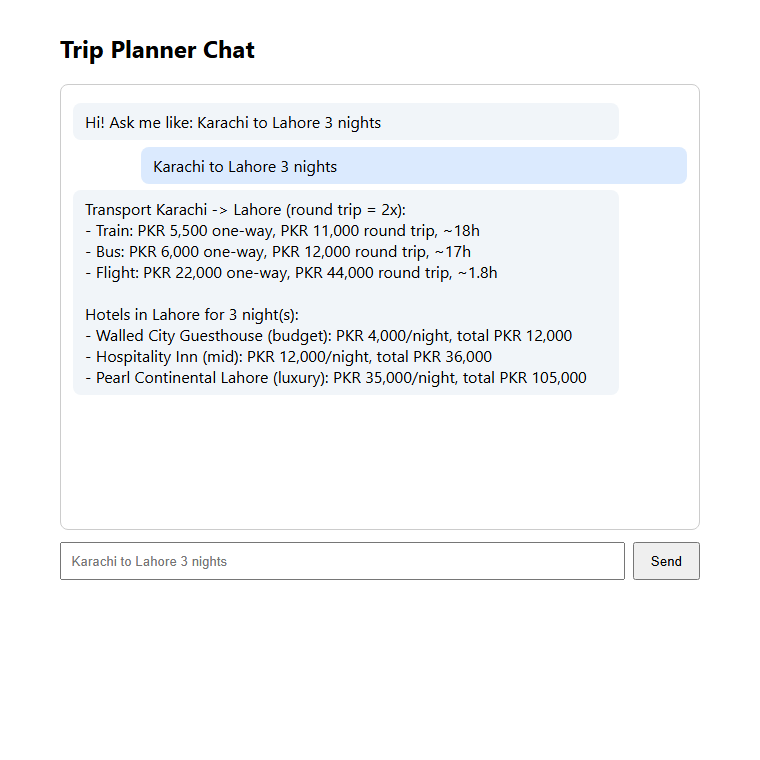
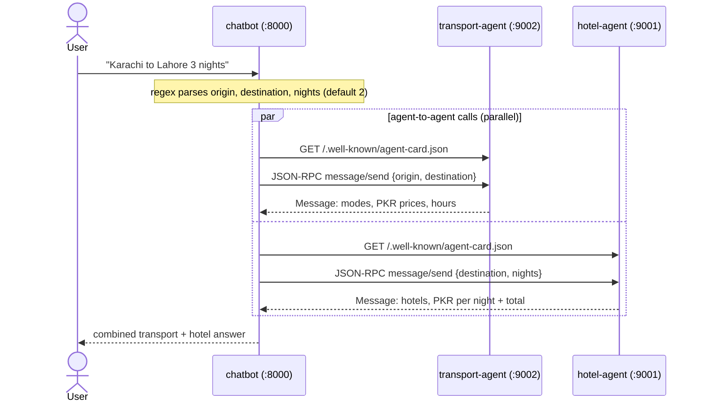

# Trip Cost Planner (A2A)

A small multi-agent demo built on the same pattern as city-explorer-agent: a front-end
(chatbot / CLI) that calls specialist agents over the A2A (Agent2Agent) protocol.
Data is mocked (Pakistani routes, prices in PKR) and there is no LLM, so it needs no keys.



## Project structure

```
trip-cost-planner/
├── README.md
├── requirements.txt
├── docs/
│   └── chatbot.png
└── trip_planner/
    ├── __init__.py
    ├── a2a_server.py        # wraps a handle(text) -> str function as an A2A server
    ├── a2a_client.py        # discovers an agent card and sends it a message
    ├── hotel_agent.py       # A2A server: hotels + stay cost        (port 9001)
    ├── transport_agent.py   # A2A server: travel modes + cost       (port 9002)
    ├── orchestrator.py      # CLI: calls both agents, prints a plan
    └── chatbot.py           # web chat UI + /chat API               (port 8000)
```

## Flow



Step by step:

1. **User message.** The browser POSTs `{"message": "..."}` to `/chat`.
2. **Parse.** `chatbot.py` extracts origin, destination and nights with a regex. If it cannot, it replies with example queries.
3. **Discover.** For each agent, `ask_agent` (`a2a_client.py`) fetches the agent card (`/.well-known/agent-card.json`) to learn its name, skills and URL.
4. **Call (A2A).** It sends a JSON-RPC `message/send` request whose text part is a small JSON payload. Both calls run in parallel with `asyncio.gather`.
5. **Agent work.** Each agent's executor (`a2a_server.py`) passes the text to its `handle()` function, looks up the mock data and enqueues a text `Message` reply.
6. **Combine.** The chatbot joins the two replies and returns them as `{"reply": "..."}`, which the page shows as a chat bubble.
7. **Errors.** Unknown routes or cities are reported by the agent itself. If an agent server is down, the chatbot says it could not reach the agents.

## Run

Install, then start each server in its own terminal from the `trip-cost-planner` folder:

    pip install -r requirements.txt
    python -m trip_planner.hotel_agent
    python -m trip_planner.transport_agent
    python -m trip_planner.chatbot

Open http://localhost:8000 and ask, for example, `Karachi to Lahore 3 nights`.
`http://localhost:8000/?q=Lahore to Islamabad 2 nights` asks immediately.

No browser needed: `python -m trip_planner.orchestrator Karachi Lahore 3` prints the same plan in the terminal.

Agent cards: http://localhost:9001/.well-known/agent-card.json and
http://localhost:9002/.well-known/agent-card.json

## Sample data (PKR)

- Routes: Karachi -> Lahore, Lahore -> Islamabad, Islamabad -> Murree
- Hotels: Lahore, Islamabad, Murree (budget / mid / luxury)

## Next steps

Swap the mock dicts for real APIs, put an LLM (Bedrock / Claude) in the agents, or let an
LLM decide which agent to call and understand free-form questions.
